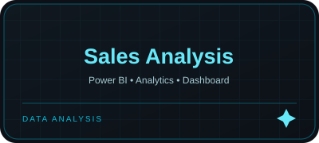

<!-- Header -->

  

<!-- Introduction -->

<!-- Projects -->

  

  
  

  
  

<!-- Contacts -->

  

  
  
  

<!-- Statistics -->

  

<!-- Contribution Snake -->

  <picture>
    <source media="(prefers-color-scheme: dark)" srcset="https://raw.githubusercontent.com/decknho/decknho/output/github-snake-dark.svg?v=999">
    <source media="(prefers-color-scheme: light)" srcset="https://raw.githubusercontent.com/decknho/decknho/output/github-snake.svg?v=999">
    
  </picture>

 
<!-- Footer -->

  

